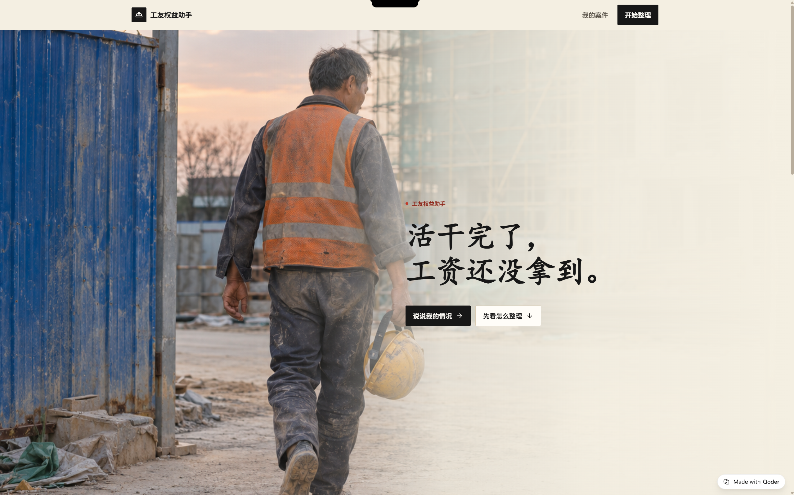
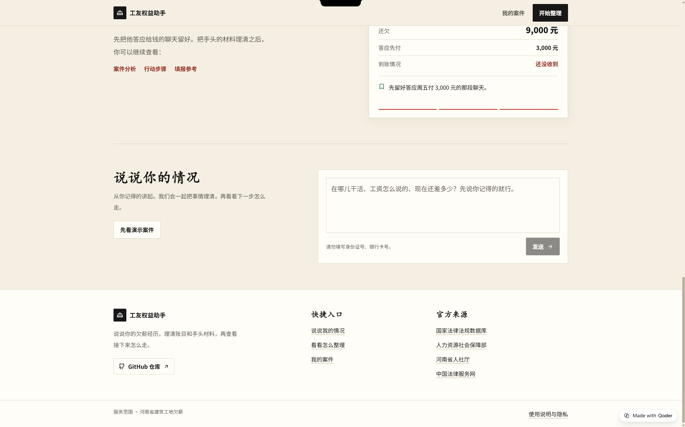
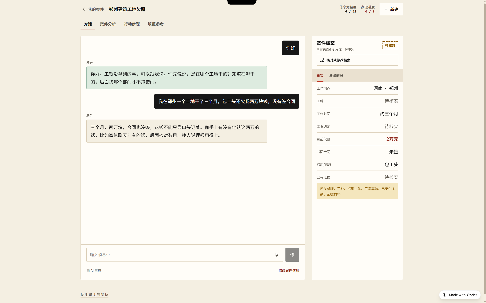
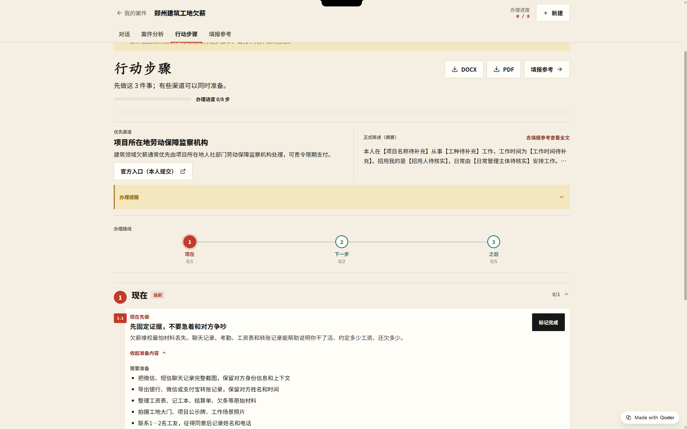
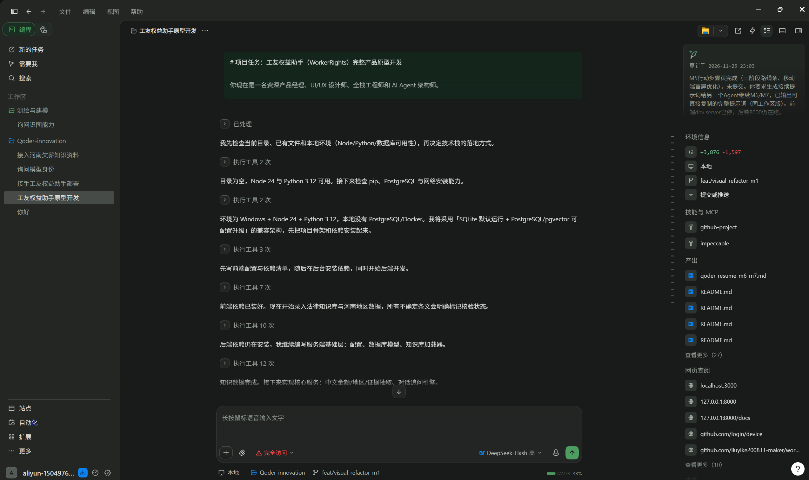
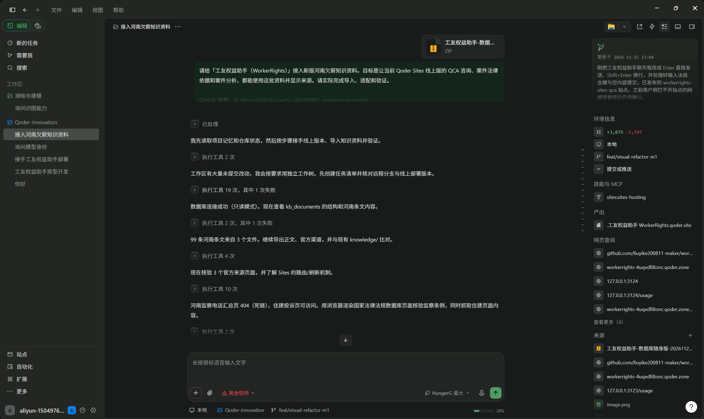

# 工友权益助手 · WorkerRights

**活干完了，工资还没拿到。我们先把事情理清，再看看下一步怎么走。**

面向河南省建筑工地欠薪场景的 AI 辅助工具：通过口语对话整理经历、核对工资与证据，再提供案件分析、行动步骤和填报参考。

**[在线体验](https://workerrights-4uqvdfi8onc.qoder.zone/)** · **[天池作品帖](https://tianchi.aliyun.com/forum/post/1110547)** · [本地运行](#本地运行) · [技术实现](#技术实现)

2026 Qoder 高校创造力大赛 · **Hack4Good 技术向善**赛道作品，由「**奶娃也爱vibe coding**」队开发，使用 Qoder 构建和修改，通过 Qoder Sites 公开部署。



## 先体验：5 步走完主要流程

线上体验无需安装软件、登录账号或填写 API Key。建议先使用虚构演示案件。

1. 打开[工友权益助手](https://workerrights-4uqvdfi8onc.qoder.zone/)，向下找到「说说你的情况」。
2. 点击 **「先看演示案件」**，进入已准备好的虚构案例。
3. 查看 **「对话」与「案件分析」**，了解事实、证据和相关参考信息。
4. 打开 **「行动步骤」**，查看「现在、下一步、之后」的材料准备事项。
5. 打开 **「填报参考」**，体验参考内容复制，或尝试导出 DOCX、PDF 材料。

也可以回到首页，用一段虚构经历从头体验多轮对话：

> 我在郑州一个工地干了三个月，包工头还欠我两万块钱，没有签合同。

<details>
<summary>查看演示入口与官方来源区域</summary>



</details>

## 为什么做这个作品

一些劳动者遭遇欠薪后，除了要追讨工资本身，还会遇到信息和表达上的困难：不知道先找谁、没有书面合同、不清楚聊天记录和记工本该怎么整理，也很难把零散经历写成清楚的事实陈述。

我们希望让用户从熟悉的日常表达开始，先讲出记得的事情，再一步步补充和核对。考虑到欠薪涉及不同行业、用工方式和地区情况，第一阶段聚焦 **河南省建筑工地欠薪**，围绕具体场景完成从描述经历到准备材料的流程。

## 从一句话到一份可核对的案件记录

**描述经历 → 整理与核对事实 → 案件分析 → 行动步骤 → 填报参考与材料导出**

| 环节 | 用户可以做什么 |
| --- | --- |
| 对话接待 | 用口语描述情况，助手结合已记录事实进行多轮追问 |
| 案件档案 | 查看工作地点、工期、招用与管理、工资约定、合同及证据，补充或更正信息 |
| 工资与证据整理 | 核对应发、已付和欠付，梳理聊天、考勤、记工和转账等已有材料 |
| 案件分析 | 查看用工关系、证据缺口、相关条文及可参考的办理渠道，保留来源与核验状态 |
| 行动步骤 | 分阶段查看准备事项，标记进度，获取沟通草稿、事实陈述与证据目录 |
| 填报参考 | 查看字段说明与参考内容，逐项复制或导出 TXT、DOCX、PDF 材料 |
| 案件管理 | 在同一浏览器继续整理案件，或删除案件、打开虚构演示 |

### 把关键事实分开记

例如，对方还欠 **9,000 元**，答应周五先付 **3,000 元**，但钱尚未到账，当前欠款仍先按 **9,000 元**记录。产品区分付款承诺与实际到账，供用户继续核对。

未知信息保留为待核实，已整理事实可以更正。修改事实后，基于旧信息生成的结果会提示需要更新。



*对话与案件档案。截图为体验过程中的状态，仍有信息待补充。*

<details>
<summary>查看行动步骤与材料清单</summary>



*「现在、下一步、之后」的分阶段指南。截图中的案件尚未补齐，正式陈述保留待填写项。*

</details>

## 用 Qoder 完成构建与迭代

团队负责确定应用场景、设计业务流程、整理资料和检查结果，通过 Qoder 完成产品构建与后续修改。

| 阶段 | Qoder 参与的工作 | 团队负责的工作 |
| --- | --- | --- |
| 原型构建 | 环境检查、项目搭建、页面与接口、数据模型及核心服务实现 | 明确服务范围、主流程和业务要求，检查运行结果 |
| Agent 与交互 | 多轮对话、事实记录、案件页面及交互调整 | 设计追问与核对流程，调整表达和页面操作 |
| 数据与知识库 | 资料导入、适配、检索接入和验证 | 整理河南欠薪资料与办理渠道，检查来源与核验状态 |
| 上线与完善 | Qoder Sites 部署、QCA 接入及后续修改 | 体验完整流程，提出问题并核对修改结果 |

<details>
<summary>查看 Qoder 原型开发与知识资料接入记录</summary>



*原型开发记录。*



*河南欠薪知识资料接入过程记录，不代表所有资料均已完成核验。*

</details>

## 技术实现

线上版本与本地开发版共用前端页面和业务约定，运行方式有所不同：

| 环境 | 前端 | 后端与数据 | 咨询能力 |
| --- | --- | --- | --- |
| 线上 | React、TypeScript、Vite 构建 | Qoder Sites Functions（Deno）与平台数据库 | Qoder Cloud Agents（QCA） |
| 本地 | Next.js、React、TypeScript | FastAPI、SQLAlchemy、SQLite | 默认规则模式，可配置 OpenAI 兼容模型服务 |

- **Agent 工具调用：** QCA 结合案件上下文开展流式多轮对话；事实记录、工资核对、法律检索等工具由站点后端执行，再按调用 ID 回传结果。
- **业务规则：** 案件分析、行动指南和填报参考结合业务规则生成。法律资料包含来源和核验状态。
- **事实一致性：** 各页面引用同一份案件事实；更正后标记旧结果过期。流式重连复用请求标识，避免同一条消息重复写入。
- **数据隔离：** 按访客和案件隔离数据；云端咨询会将必要的消息和案件上下文交给 QCA 处理。

### 仓库结构

```text
frontend/           React 页面、组件和 API 客户端
  app/              首页、案件列表、对话、分析、行动与填报页面
  sites/            Qoder Sites 的 Vite 入口与路由适配
backend/            本地 FastAPI、SQLite、Agent 和业务规则
sites-functions/    线上 Deno Functions、数据库定义和迁移测试
  app/core/         事实、法律检索、派生结果与导出
  app/qca/          QCA 会话、流式事件与服务端工具调用
knowledge/          法律、地区及官方渠道数据
tests/              本地后端和前端回归测试
docs/               产品、架构、接口和设计验收文档
  assets/submission/ 作品界面与 Qoder 开发过程配图
```

## 本地运行

建议使用 **Node.js 24、Python 3.11 或以上版本**。以下为 Windows PowerShell 命令。

### 1. 获取代码并启动后端

```powershell
git clone https://github.com/liuyike200811-maker/workerrights.git
cd workerrights

py -3 -m venv .venv
.\.venv\Scripts\python.exe -m pip install -r backend/requirements.txt
.\.venv\Scripts\python.exe -m backend.database.init_db
.\.venv\Scripts\python.exe -m uvicorn backend.main:app --host 127.0.0.1 --port 8000
```

### 2. 启动前端

另开一个终端，进入克隆后的仓库根目录：

```powershell
cd frontend
npm ci
npm run dev
```

打开 [本地前端](http://localhost:3000)，API 文档位于 [FastAPI Docs](http://127.0.0.1:8000/docs)。

### 3. 按需配置模型

本地默认 `LLM_PROVIDER=mock`，使用确定性规则引擎，并非大模型对话。若需调试真实模型，复制 [.env.example](.env.example) 为 `.env`，按示例设置 `LLM_PROVIDER=openai_compatible`、服务地址、模型名与密钥。详见 [Agent v1 接入说明](docs/agent-v1.md)。

密钥只放服务端，不提交 `.env`。线上 QCA 与本地 OpenAI 兼容配置是两条独立的接入路径。

## 测试与构建

以下命令供本地开发时运行。

在仓库根目录执行后端及 Sites Functions 测试：

```powershell
.\.venv\Scripts\python.exe -m pytest tests -q
node --experimental-strip-types --test sites-functions/dev/*.test.mjs
```

前端测试、类型检查与 Sites 构建：

```powershell
cd frontend
npm test
npx tsc --noEmit
npm run build:sites
```

`npm run build:sites` 生成 `frontend/dist/`，用于 Sites 前端发布；`npm run build` 构建 Next.js 本地版本。前端构建产物之外，线上运行还需要 Sites Functions、平台数据库和服务端 QCA 配置。

## 使用范围与数据说明

- 首期聚焦河南省建筑工地欠薪，提供事实整理、材料准备和办理参考。
- 参考内容由用户核对；正式反映问题由用户在官方渠道自行提交。产品不自动登录或提交政府平台。
- 请勿输入身份证号、银行卡号等敏感信息，首次体验建议使用虚构案例。
- 部分地方资料和渠道仍待核验，以官方发布与受理要求为准。真实案件的追薪效果尚未验证，不承诺追回工资或案件结果。

## 团队与参赛信息

**奶娃也爱vibe coding**：来自河南郑州高校的大二学生团队。

| 分工 | 负责内容 |
| --- | --- |
| 领队 | Agent 搭建、对话流程与事实核对设计 |
| 前端 | 页面构建、交互与展示调整 |
| 后端与知识库 | 数据库、法律资料及办理渠道整理与接入 |

- **比赛：** [2026 Qoder 高校创造力大赛](https://tianchi.aliyun.com/competition/entrance/532536/introduction)
- **赛道：** Hack4Good 技术向善
- **作品介绍：** [天池作品帖](https://tianchi.aliyun.com/forum/post/1110547)
- **在线应用：** [工友权益助手](https://workerrights-4uqvdfi8onc.qoder.zone/)

## 进一步阅读

[产品需求](docs/product-requirements.md) · [系统架构](docs/architecture.md) · [API 参考](docs/api-reference.md) · [法律数据规范](docs/legal-data-schema.md) · [设计验收记录](docs/redesign/)

部分开发文档保留了早期原型与迁移阶段的记录，当前线上与本地运行方式见本 README。

## 许可证

代码采用 [MIT License](LICENSE)。法律法规引用以官方发布文本为准。
